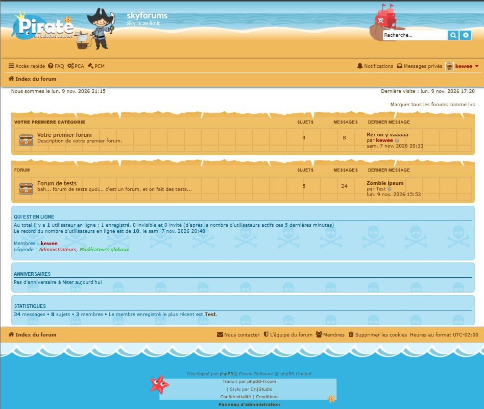

# Pirate 🏴‍☠️

A cheerful pirate-themed style for **phpBB 3.3**.

Sandy colours, treasure-chest icons, torn parchment edges and an animated ocean header bring a little adventure to your forum. Welcome aboard!

## Features

- Animated waves in the header.
- Custom treasure-chest forum icons.
- Torn parchment borders.
- A playful seaside colour scheme.

## Downloads

Find ready-to-install packages on the [Releases page](https://github.com/Kewee/phpbb-style-pirate/releases).

## Installation

Extract the release archive and copy the Pirate folder containing `style.cfg` into your forum’s `styles` directory.

Install the style from the phpBB Administration Control Panel.

## Author

Created by **Kewee** — [CRI Studio](https://cristudio.fr/).

## License

See the license file included with the style.
